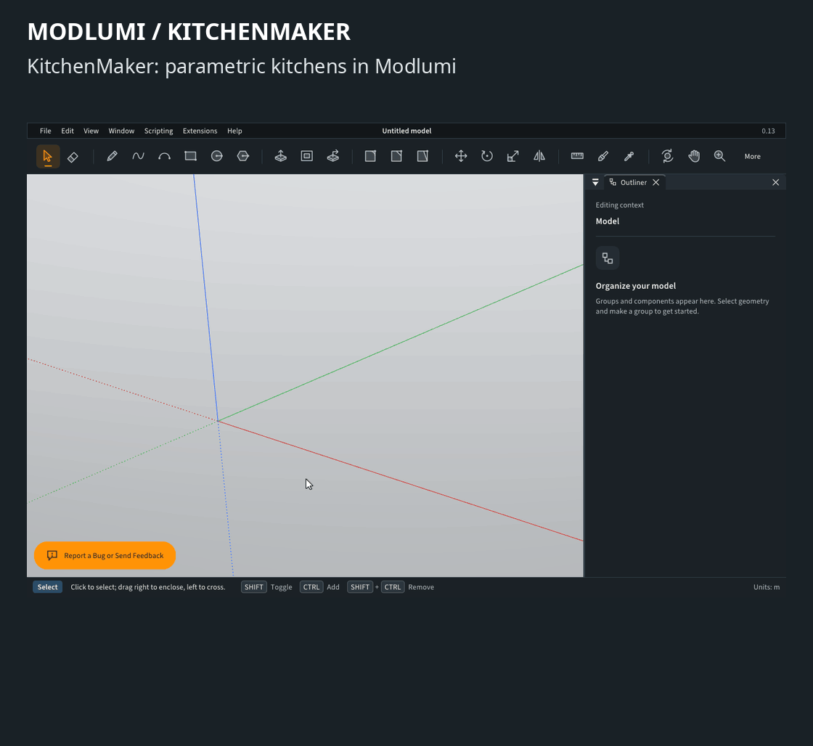

# KitchenMaker for Modlumi

Parametric kitchen cabinets for [Modlumi](https://modlumi.com), ported from **IngeTrazo
KitchenMaker V.2** for SketchUp 2017: a cabinet library, rows, opening doors, finishes, a
continuous worktop with sink and hob cutouts, a cut list and a cost report with CSV export.
Licensed GPL-3.0-or-later, like the original.

**Status:** experimental.

The interface follows the user's language: English or French, the two languages the original
ships; other languages fall back to English. Numbers in reports and CSV files follow the user's
regional settings (decimal separator, spreadsheet column separator). Values stored in the model
stay in English, so a model opens in any language.

## Installation

In Modlumi Desktop, choose **Extensions › Manage Extensions... › Install plugin...** and pick this
folder's `plugin.json`. Allow file dialogs to export CSV files; without that permission the export
buttons stay greyed out and say why.

KitchenMaker needs a Modlumi version with the plugin features `viewport`, `files`,
`toolSelection`, `propertiesWhen`, `previewBoxes`, `formValidation`, `listWidget`, `locale`,
`numberFormat` and `tableActivation`; an older version refuses the plugin and says so.

## Usage

- **Extensions › KitchenMaker › Library** opens the panel: category, model, then every setting of
  the cabinet. A refused value shows in red under its field.
- **Place with the Mouse** (in the panel) or **Place Cabinet** selects the placement tool: a click
  places the cabinet using Modlumi's inference and returns to the Select tool, as Esc does.
  **X** turns the cabinet 90°, and typing an angle then Enter turns it by that angle; placement
  starts from the panel's rotation. The panel can also create the cabinet at exact coordinates, or
  to the left or right of the selected cabinet (at the panel's Z height for a wall cabinet next to
  a base cabinet, and the other way round).
- Select a cabinet or a worktop and its settings appear in **Properties**; each change rebuilds it
  as one undo step. A worktop's cutouts can be added, removed and moved there.
- Right-click cabinets for Add to the Right / Left, Open / Close, Swap Hinge, Finishes...,
  Align in a Row... and Continuous Worktop....
- **Continuous Worktop...** puts one worktop over a row of base cabinets, with up to six sink or hob
  cutouts, each centred on a supporting cabinet.
- **Convert SketchUp Cabinets** makes the cabinets and worktops of KitchenMaker for SketchUp in an
  opened .skp file editable; KitchenMaker also offers it when such a file opens.
- **Cut List** and **Cost Report** open in windows. Double-click a row to select its cabinets and
  show them; **Export CSV...** saves them for a spreadsheet (lengths in millimetres).

## Differences from the SketchUp version

- Lengths follow the Modlumi model's units; CSV files stay in millimetres.
- Doors and drawers are groups that swing or slide; every part is a solid.
- The sink and hob are real holes cut into the worktop with a boolean.
- Cabinets and worktops made by the SketchUp version (V.1 or V.2) are converted when a .skp file
  opens, after asking, or with **Convert SketchUp Cabinets**. Each becomes a KitchenMaker group with
  the same settings in the same place; one whose settings KitchenMaker can't build stays as it was.
  This needs a Modlumi version with the plugin feature `skpAttributes`; older versions keep
  the command greyed out.
- Cabinets nested in groups or components appear in the reports, but double-click can only select
  them while their group is open.
- A cabinet resized with the Scale tool is refused by Align in a Row, Continuous Worktop and Add to
  the Left/Right, and the reports flag it, because they use its KitchenMaker dimensions. Set its
  dimensions in Properties instead.
- Materials are recognised by their extension data, like the original's "IKM" names: a user
  material with the same name stays separate, and switching language doesn't create new ones.
  Their names, prefixed "KitchenMaker", use the language in effect when they were created.

## Changes in 2.3.0 (since 2.2.0)

- Cabinets and continuous worktops made by KitchenMaker V.1 or V.2 for SketchUp, read from the
  `ingetrazo_kitchen_maker` and `ingetrazo_kitchenmaker_v2_worktop` attribute dictionaries, are
  converted into editable KitchenMaker groups (needs Modlumi's `skpAttributes` feature).

## Changes in 2.2.0 (since 2.1.0)

- English and French interface following `context.locale` (2.1.0 was French only); material and
  part names in the user's language.
- The placement tool's preview uses `view.box` instead of twelve hand-drawn segments per box.
- **X** turns the cabinet 90° while placing, and a typed angle sets it (2.1.0 only had the
  Rotation field in the tool options). The panel selects the tool from a button.
- Validation errors show under the field concerned (the `error` option) instead of one message at
  the bottom.
- Two Properties sections, cabinet and worktop, filtered with `when` instead of one shared section.
- Cutouts are a list (`ui.list`) of up to six instead of one fixed sink and one fixed hob; they
  can also be edited from the worktop's Properties.
- Double-clicking a row in the cut list or cost report (`onActivate`) selects its cabinets and
  moves the camera to them.
- CSV through `context.formatCsv` and amounts through `context.formatNumber`, following regional
  settings, instead of hard-coded semicolons and decimal commas. Export buttons in the report
  windows, in addition to the commands.

## Development

`modlumi.d.ts` is a copy of Modlumi's plugin API types. Type-check the plugin with
`tsc -p jsconfig.json`.
